# 4. Informe de análisis de los datos

Análisis exploratorio de la demanda y el precio de la electricidad en España, y desarrollo y validación de los modelos predictivos. Las figuras y cifras se regeneran con `python scripts/informe_analisis.py` (resumen numérico en `docs/figuras/resumen_analisis.json`).

## 4.1 Calidad de los datos

Resultado del informe de validación del ETL (`data/processed/validacion_electricidad.json`), última ejecución el 23-11-2026:

| Tabla | Filas | Periodo | Duplicados | Huecos | Fuera de rango | Observaciones |
|---|---|---|---|---|---|---|
| Demanda diaria | 5.805 | 01-01-2011 → 22-11-2026 | 0 | 0 | 0 | Serie completa |
| Demanda mensual por CCAA | 2.520 | 01-2015 → 08-2026 | 0 | 0 | 0 (2 anulados) | Melilla sin datos en la API. Dos valores **negativos** de Cantabria (jul. y ago. 2026) son un error de la fuente: la limpieza los anula |
| Precio horario | 113.016 | 01-01-2014 → 22-11-2026 | 0 | 0 | 0 | El PVPC solo existe desde el 01-06-2021 (nueva tarifa 2.0TD): 64.991 horas anteriores sin PVPC |
| Temperatura diaria (AEMET) | 5.803 | 01-01-2011 → 20-11-2026 | 0 | 0 | — | 18 estaciones (17,7 con dato de media al día). AEMET publica con ~2 días de retraso; esos días se rellenan con la temperatura normal |

Incidencias encontradas y corregidas durante el desarrollo, todas con un test automático asociado:

1. La API **añade el día en curso** (provisional e incompleto) aunque se pida hasta ayer. Se recorta.
2. La API devuelve error 502 permanente para Melilla. El ETL avisa y continúa.
3. Demanda autonómica negativa en la fuente. Se anula en la limpieza y no se carga en el warehouse.
4. Desde octubre de 2025 el precio es cuartohorario. Se agrega a la hora.
5. AEMET limita las consultas a 6 meses y a unas pocas peticiones por minuto (error 429). El cliente trocea por semestres, pide las 18 estaciones en una sola consulta y espera más tras un 429. Si falta la previsión de una comunidad, los pesos de las demás se reescalan.

## 4.2 Demanda eléctrica

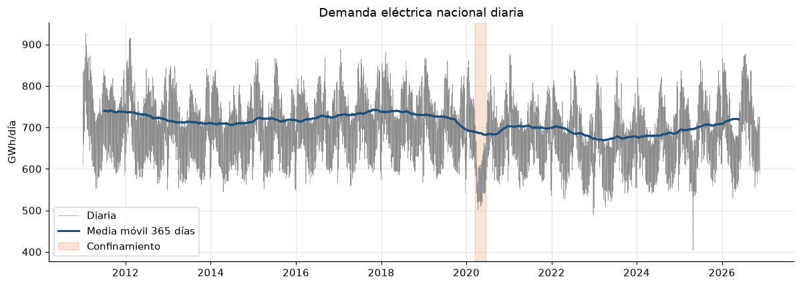

| Año | 2011 | 2013 | 2015 | 2017 | 2019 | 2020 | 2021 | 2022 | 2023 | 2024 | 2025 |
|---|---|---|---|---|---|---|---|---|---|---|---|
| TWh | 270,0 | 260,6 | 262,8 | 267,9 | 264,7 | 250,1 | 256,5 | 250,5 | 246,7 | 249,0 | 256,3 |

- **Tendencia**: la demanda nacional es prácticamente plana desde 2011 (≈ 711 GWh/día de media), con una ligera bajada hasta 2023 por eficiencia energética y autoconsumo solar, que no pasa por la red. 2025 marca un repunte (+2,9 % sobre 2024), coherente con la electrificación y los nuevos consumos como los CPD.
- **Eventos**: el confinamiento de 2020 bajó la demanda anual un 5,5 %. El día de menor demanda de toda la serie es el **28-04-2025 (403 GWh)**, el día del apagón peninsular. El máximo es el 25-01-2011 (926 GWh), una ola de frío.

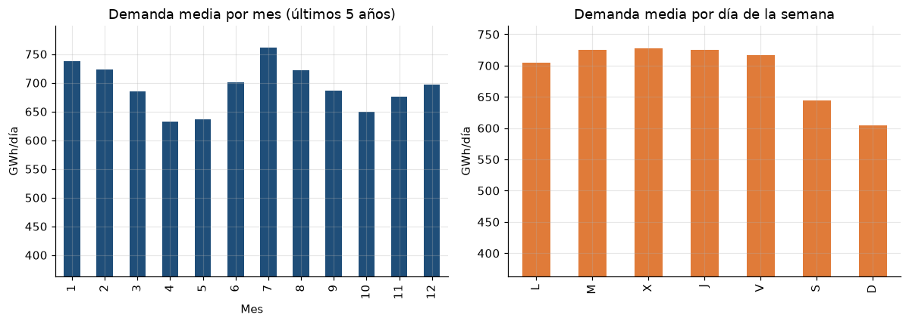

- **Estacionalidad anual doble**: máximos en invierno (calefacción) y verano (aire acondicionado) y mínimos en primavera y otoño.
- **Estacionalidad semanal**: el fin de semana la demanda cae un **13,2 %** respecto a los laborables. Por eso el calendario (fin de semana, festivos, puentes) es imprescindible en el modelo.

## 4.3 Precio de la electricidad

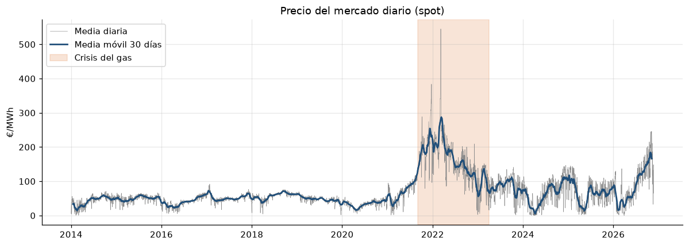

| Año | 2014 | 2016 | 2018 | 2019 | 2020 | 2021 | 2022 | 2023 | 2024 | 2025 | 2026 (hasta 19-11) |
|---|---|---|---|---|---|---|---|---|---|---|---|
| €/MWh | 42,1 | 39,7 | 57,3 | 47,7 | 34,0 | 111,9 | 167,5 | 87,1 | 63,0 | 65,3 | 88,2 |

- **Tres regímenes**: estable entre 35 y 60 €/MWh (2014-2020); **crisis del gas** (2021-2023), con un máximo diario de **545 €/MWh el 08-03-2022**; y vuelta a niveles de 60-90 €/MWh con mucha más volatilidad desde 2024.
- **Precios cero y negativos**: 2.820 horas con precio ≤ 0 €/MWh, el 90 % desde 2024 (784, 797 y 950 horas en 2024, 2025 y 2026) por exceso de producción renovable. Antes solo hubo episodios aislados (177 horas en la primavera de 2014, muy eólica, y 112 en 2022-2023).
- 2026 muestra una subida fuerte en el segundo semestre (167 €/MWh de media en octubre).

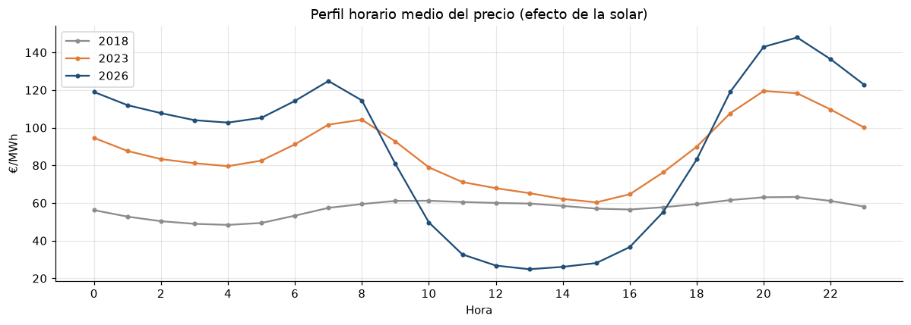

El **perfil horario se ha invertido**. En 2018 la hora más cara era por la noche y la diferencia entre horas era pequeña. En 2026 el precio cae a unos 25 €/MWh entre las 12 y las 15 h (la "curva de pato" de la solar) y supera los 140 €/MWh a las 20-21 h. Para un CPD con consumo constante, esto implica que la **producción fotovoltaica propia** o un contrato a largo plazo (PPA) solar cubre justo las horas baratas, y que el riesgo de coste está en las horas nocturnas.

## 4.4 Correlación entre demanda y precio

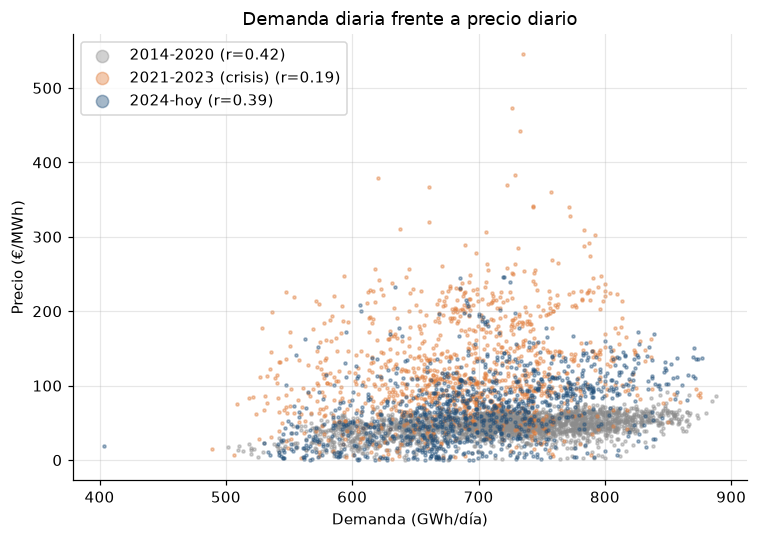

| Periodo | Correlación de Pearson (demanda diaria, precio diario) |
|---|---|
| 2014-2020 | 0,42 |
| 2021-2023 (crisis) | 0,19 |
| 2024-hoy | 0,39 |

Existe una correlación positiva moderada: los días de más demanda necesitan centrales más caras (ciclos combinados de gas). Durante la crisis la relación casi desaparece, porque el precio lo dominaba el precio del gas y no la demanda. Conclusión para el modelo: la demanda explica solo una parte del precio, y las variables más determinantes (precio del gas, del CO₂, viento y sol) no están en los datos actuales. Es una **mejora identificada** para versiones futuras.

## 4.5 Distribución territorial

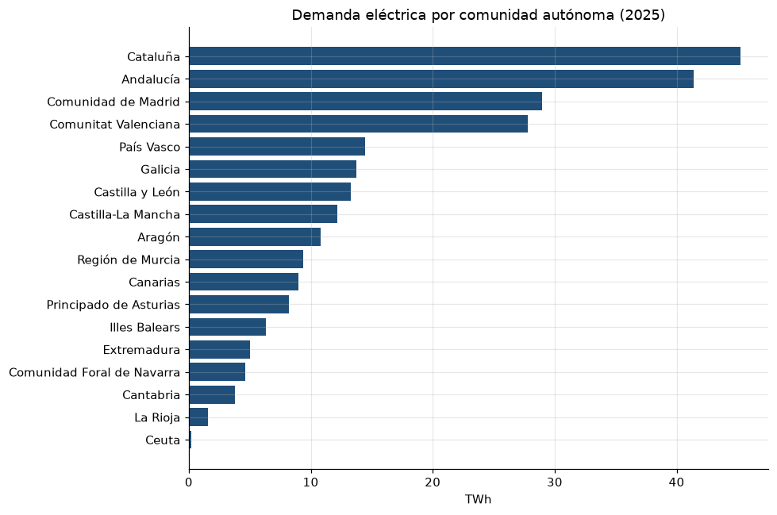

En 2025, **Cataluña (45,3 TWh), Andalucía (41,4 TWh), la Comunidad de Madrid (29,0 TWh) y la Comunitat Valenciana (27,8 TWh)** concentran el 56 % de la demanda. Son también las zonas con más CPD en España (Madrid y Barcelona, según PeeringDB). Para la viabilidad, la demanda autonómica sirve para medir el **peso relativo** de un CPD nuevo sobre la red regional: un CPD de 50 MW pesa mucho más en La Rioja (1,5 TWh) que en Cataluña.

## 4.6 Demanda horaria y potencia punta

La red eléctrica no se dimensiona para la energía diaria sino para la **punta**: la hora de máxima demanda. Para saber si hay "disponibilidad energética" para un CPD hay que mirar la punta. Desde 2019 REE publica la demanda peninsular cada 5 minutos: 68.969 horas.

| Tabla | Filas | Periodo | Huecos | Observaciones |
|---|---|---|---|---|
| Demanda horaria peninsular | 68.969 | 01-01-2019 → 22-11-2026 | 223 horas | Unos 11 días en los que la fuente no tiene lecturas de 03:00 a 21:00 (comprobado pidiéndolos uno a uno). No se inventan: la vista `vw_punta_diaria` cuenta las horas de cada día y el modelo interpola esos días. El apagón del 28-04-2025 (mínimo de unos 2.100 MW) se conserva porque es un dato real |

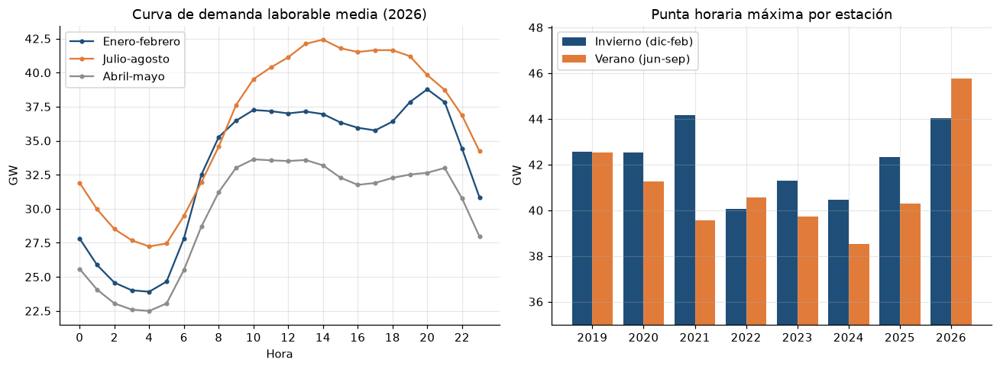

- **La forma del día cambia con la estación.** En invierno la punta es a las **20 h** (iluminación y calefacción al volver a casa). En verano es a las **14 h**, con una meseta de 41-42 GW entre las 12 y las 18 h (aire acondicionado). En primavera la curva es mucho más baja.
- **La punta de verano ya supera a la de invierno.** Hasta 2025 el máximo anual solía ser invernal (récord de 44.153 MW en 2021). En 2026 el verano marcó **45.772 MW el 23-07-2026 a las 14 h**, y las cinco puntas más altas de la serie son de julio y septiembre de 2026, todas a las 14 h.
- **Consecuencia para un CPD**: su consumo de refrigeración es máximo justo en las horas punta de verano. A cambio, esas mismas horas de mediodía son las de precio más bajo gracias a la solar (sección 4.3), así que la fotovoltaica propia reduce a la vez el coste y el peso sobre la punta.

## 4.7 Modelos predictivos

### Ingeniería de variables

Aplicando las técnicas de la sesión de *Advanced Feature Engineering*, el modelo de corto plazo usa estas variables, todas calculadas solo con información disponible antes del día a predecir:

| Grupo | Variables | Por qué |
|---|---|---|
| Calendario | Día de la semana, mes, día del año, fin de semana, agosto, Navidad | La demanda cae un ~15-20 % el fin de semana y en agosto |
| Festivos | Festivo nacional y **puente** (laborable entre festivo y fin de semana) | Conocimiento del dominio: un puente se comporta casi como un festivo |
| Estacionalidad | 3 pares seno/coseno de periodo anual (Fourier) | Describen de forma suave el ciclo invierno-primavera-verano |
| Retardos (lags) | Valor de hace 1, 2, 7, 14 y 364 días (precio: también 28) | Lo más informativo: cómo fue el pasado reciente y el mismo día del año anterior |
| Ventanas móviles | Media, desviación, mínimo y máximo de 7 y 28 días (precio: también 90) | Nivel y volatilidad recientes, suavizando el ruido |
| Diferencias | Variación respecto a la semana anterior | Captura la tendencia de corto plazo |
| Eventos | Confinamiento, crisis del gas, excepción ibérica, apagón | Periodos anómalos que el modelo no puede deducir solo |
| **Temperatura** (consumo y punta) | Temperatura media, máxima y mínima; grados-día de frío (base 15 °C) y de calor (base 21 °C); media de grados-día de los últimos 3 días; máxima del día anterior | La demanda tiene forma de U frente a la temperatura (ver 4.7). La media de 3 días recoge la **inercia térmica** de los edificios en las olas de calor |

Las ventanas se calculan sobre la serie desplazada un día para evitar la **fuga de información** (*data leakage*): un test automático comprueba que la variable del día *t* nunca usa el valor de *t*.

Para la demanda se modela el **logaritmo**, que estabiliza la varianza y convierte los errores en relativos. Para el precio diario no se puede usar, porque desde 2024 hay días a 0 €/MWh y horas negativas.

### Modelos

| Horizonte | Modelo | Detalle |
|---|---|---|
| Corto plazo (días) | `HistGradientBoostingRegressor` (scikit-learn) | 600 árboles, tasa de aprendizaje 0,05, 31 hojas, regularización L2. **Predicción recursiva**: cada día predicho alimenta los retardos del siguiente. |
| Largo plazo del consumo (meses, 10 años) | Holt-Winters (statsmodels) | Nivel + tendencia **amortiguada** + estacionalidad anual sobre el logaritmo. La amortiguación evita extrapolar en línea recta durante 10 años. |
| Largo plazo del precio (meses, 10 años) | AR(1) con constante sobre el logaritmo (SARIMAX de statsmodels) | **Reversión a la media**: tras un periodo extremo, la previsión vuelve gradualmente a la media histórica y el intervalo queda acotado. |
| Referencias | Ingenuo semanal (mismo día de la semana anterior), ingenuo anual (mismo día del año anterior) e ingenuo mensual (mismo mes del año anterior) | Un modelo solo es útil si los mejora. |

### Validación

Se usa **validación con origen móvil** (*walk-forward*), que respeta el orden temporal:

- **Corto plazo**: 12 cortes consecutivos. En cada uno se entrena con todo el histórico anterior y se predicen recursivamente los 30 días siguientes, lo que cubre el último año completo.
- **Largo plazo**: 3 cortes separados 6 meses, prediciendo 24 meses en cada uno.

Métricas: MAE, RMSE, MAPE (solo con valores lejos de cero), R² y **MASE**, que es el MAE dividido por el del modelo ingenuo semanal en todo el histórico: un valor por debajo de 1 indica que el modelo lo mejora.

**Intervalos de confianza.** En el corto plazo, el intervalo del 90 % se calibra con los cuantiles 5 % y 95 % del error real del backtesting en cada paso del horizonte (día 1, día 2…). Así refleja lo que el modelo se equivoca de verdad y se abre con el horizonte. En el largo plazo, para el consumo se simulan 1.000 trayectorias del modelo Holt-Winters; para el precio se usa el intervalo analítico del modelo AR(1).

### Resultados: consumo

**Temperatura.** El análisis de errores del primer modelo mostró que fallaba sobre todo en verano: un 5,6 % de MAPE en septiembre frente a un 1,9 % en octubre, con los peores días del 4 al 8 de septiembre de 2026, una ola de calor. Por eso se añadió la temperatura de AEMET: una estación por comunidad autónoma, ponderada por la demanda eléctrica de cada comunidad.

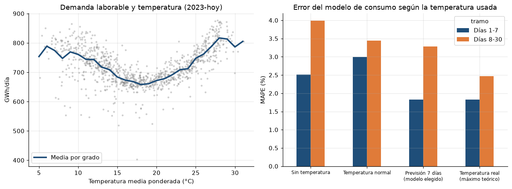

La demanda laborable tiene **forma de U** frente a la temperatura media ponderada: es mínima hacia los **18 °C (658 GWh/día)** y sube con el frío (calefacción) y, más todavía, con el calor (aire acondicionado): **817 GWh/día a 28 °C, un 24 % más**.

Para predecir hace falta la temperatura **futura**, que no se conoce. Se comparan cuatro formas de usarla:

| Modelo | Temperatura en los días a predecir | MAPE días 1-7 | MAPE días 8-30 |
|---|---|---|---|
| Sin temperatura | — | 2,51 % | 3,99 % |
| Temperatura normal | La media histórica de esa fecha (climatología) | 2,99 % | 3,44 % |
| **Previsión a 7 días (elegido)** | **La previsión de AEMET los 7 primeros días y la normal después** | **1,82 %** | **3,28 %** |
| Temperatura real | La observada (solo como máximo teórico; en la práctica no se conoce) | 1,82 % | 2,47 % |

En el backtesting, la "previsión" de los 7 primeros días es la temperatura observada. Es una aproximación optimista, porque los errores de la previsión de AEMET a 1-3 días son de 1-2 °C. En producción se usa la previsión real, que el ETL descarga cada día (`prevision_temperatura.parquet`). Usar la temperatura normal desde el primer día empeora los días 1-7: cuando hace un tiempo anormal, la temperatura normal engaña al modelo más que no usar ninguna.

**Corto plazo** (12 cortes de 30 días, del 28-11-2025 al 22-11-2026, 360 días predichos):

| Modelo | MAE (MWh/día) | RMSE (MWh/día) | MAPE | MASE |
|---|---|---|---|---|
| **Gradient boosting con temperatura (previsión 7 días)** | **21.395** | **28.265** | **2,94 %** | **0,71** |
| Gradient boosting sin temperatura | 26.623 | 33.949 | 3,65 % | 0,88 |
| Gradient boosting con temperatura normal | 24.182 | 30.505 | 3,34 % | 0,80 |
| Gradient boosting con temperatura real (máximo teórico) | 16.490 | 21.147 | 2,32 % | 0,55 |
| Ingenuo semanal | 41.252 | 56.690 | 5,69 % | 1,37 |
| Ingenuo anual | 35.762 | 49.544 | 4,89 % | 1,18 |

Con la temperatura, el modelo **reduce el error un 19 %** respecto al mismo modelo sin ella, un 48 % respecto al ingenuo semanal y un 40 % respecto al ingenuo anual. Hasta el 2,32 % de la previsión perfecta queda margen, que se podría aprovechar con previsiones meteorológicas a más de 7 días.

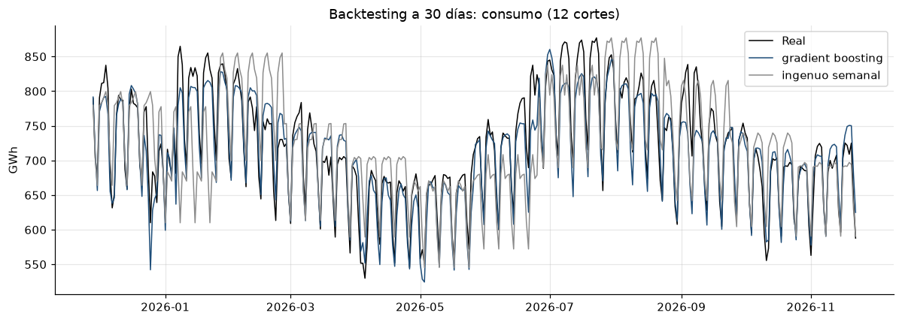

**Largo plazo** (3 cortes de 24 meses):

| Modelo | MAE (MWh/mes) | MAPE | MASE |
|---|---|---|---|
| **Holt-Winters amortiguado** | **610.594** | **2,78 %** | **0,89** |
| Ingenuo anual | 722.125 | 3,32 % | 1,05 |

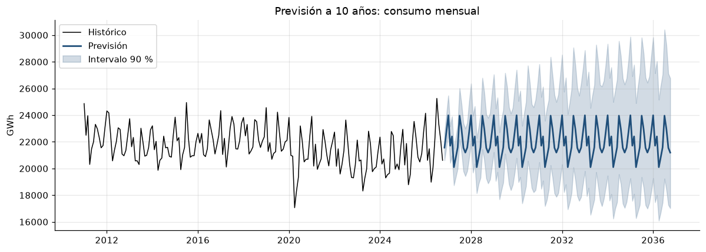

**Previsión**: la demanda nacional se estabiliza en torno a **265 TWh/año** (escenario central), con un intervalo del 90 % que se abre de 245-285 TWh en 2027 a 213-330 TWh en 2035. El modelo estadístico no incorpora cambios estructurales futuros (vehículo eléctrico, bombas de calor, hidrógeno, nuevos CPD), que empujarían la demanda hacia la parte alta del intervalo. Por eso el simulador permite añadir el consumo de un CPD concreto sobre esta base (`consumo.anadir_cpd`).

### Resultados: potencia punta

Objetivo: la **punta horaria** de cada día (la mayor de las 24 medias horarias, en MW), la misma definición que usa la previsión oficial de REE. Se usan los modelos genéricos con temperatura y, a largo plazo, la punta máxima de cada mes.

**Corto plazo** (12 cortes de 30 días):

| Modelo | MAPE días 1-7 | MAPE días 8-30 | MAPE total | MAE (MW) |
|---|---|---|---|---|
| **Temperatura los días 1-7 y sin ella después (elegido)** | **2,78 %** | **5,92 %** | **5,19 %** | **1.978** |
| Sin temperatura | 3,90 % | 5,92 % | 5,45 % | 2.078 |
| Temperatura prevista 7 días y normal después | 2,78 % | 6,87 % | 5,91 % | 2.253 |
| Temperatura real (máximo teórico) | 2,78 % | 4,96 % | 4,45 % | 1.668 |
| Ingenuo semanal | 4,04 % | 6,26 % | 5,74 % | 2.115 |
| Ingenuo anual | 8,00 % | 7,39 % | 7,53 % | 2.863 |

A diferencia de la energía diaria, en la punta **usar la temperatura normal a partir del día 8 empeora el modelo**. La punta depende tanto del calor que, en un verano anómalo como el de 2026, suponer un tiempo normal la infravalora (sesgo del −4,8 %; los peores errores son la ola de calor de septiembre). Se probó a mantener durante unos días la anomalía de temperatura de la última semana, pero mejoraba poco la punta y empeoraba el consumo. La solución elegida es un **modelo por horizonte** (`ModeloPorHorizonte`): el modelo con temperatura los 7 primeros días y el modelo sin temperatura después, que conserva en sus retardos si el periodo está siendo anómalo.

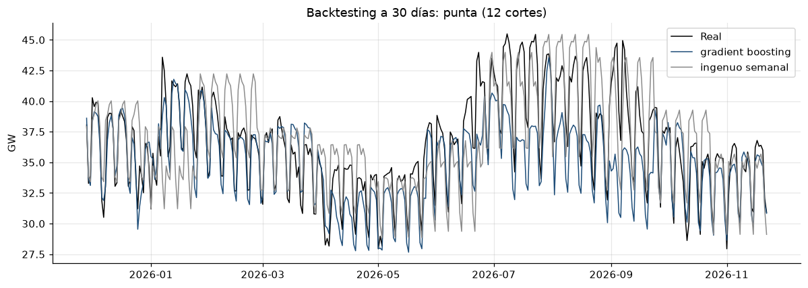

**Comparación a 1 día con la previsión oficial de REE** (últimos 60 días):

| Previsión | MAE (MW) | MAPE |
|---|---|---|
| Previsión oficial de REE | 265 | 0,78 % |
| Modelo propio (con la temperatura del día) | 700 | 2,04 % |

A 1 día, la previsión de REE es claramente mejor: usa información que no es pública, como la previsión meteorológica horaria o la demanda en tiempo real. El modelo propio no compite en ese horizonte. Su valor está en los horizontes que REE no publica (30 días y 10 años), que son los que importan para decidir la ubicación de un CPD.

**Largo plazo** (3 cortes de 24 meses): Holt-Winters MAPE 5,18 % frente a 5,55 % del ingenuo anual.

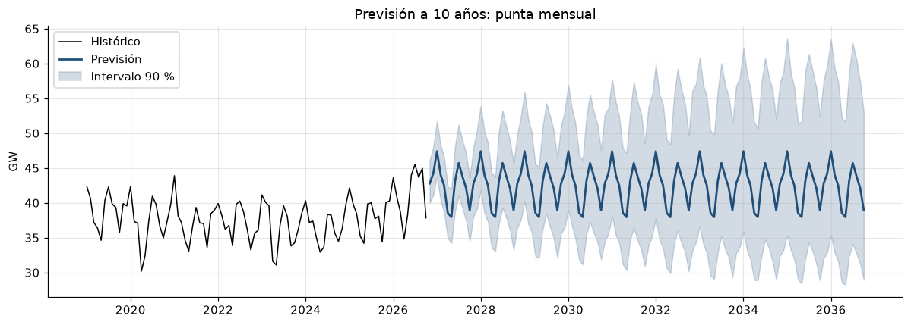

La previsión sitúa la punta anual en unos **47 GW** desde 2027, con un intervalo del 90 % que se abre hasta 35-64 GW en 2035. Hay que tomarla con cautela: con solo 7 años de historia, el modelo extrapola el salto de 2026. Si ese salto es estructural (calor más frecuente, electrificación, nuevos CPD), se marcarían récords cada verano; si fue un año excepcional, la punta volverá a 41-44 GW.

### Resultados: precio

**Corto plazo** (12 cortes de 30 días):

| Modelo | MAE (€/MWh) | RMSE (€/MWh) | R² | MASE |
|---|---|---|---|---|
| **Gradient boosting** | **29,0** | **37,5** | **0,53** | 1,83 |
| Ingenuo semanal | 30,7 | 42,3 | 0,40 | 1,93 |
| Ingenuo anual | 52,3 | 65,9 | -0,46 | 3,29 |

El gradient boosting mejora a los dos modelos de referencia, sobre todo en RMSE (-11 %), es decir, en los errores grandes. La mejora es mucho menor que en la demanda: el precio diario depende del viento, del sol y del gas, que el modelo no conoce. El MASE es mayor que 1 porque el último año ha sido mucho más volátil que la media histórica con la que se calcula la escala, y en ese año los modelos de referencia también fallan más.

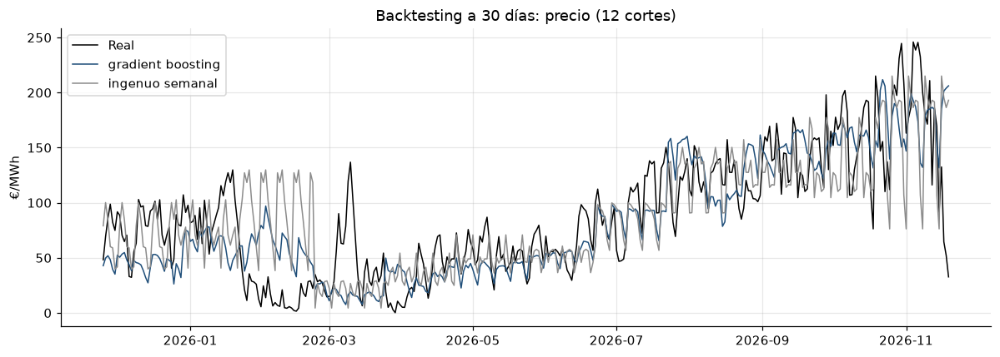

**Largo plazo** (3 cortes de 24 meses):

| Modelo | MAE (€/MWh) | RMSE (€/MWh) |
|---|---|---|
| Reversión a la media AR(1) (elegido) | 31,6 | 40,2 |
| Holt-Winters amortiguado (descartado) | 35,7 | 44,7 |
| Ingenuo anual | 29,0 | 35,5 |

Ningún modelo estadístico predice bien el precio a 24 meses: los periodos de validación (2023-2026) incluyen la salida de la crisis del gas y la subida de 2026. Se descartó Holt-Winters porque, además de ser peor, su intervalo a 10 años iba de 3 a más de 7.000 €/MWh. Se elige el modelo de **reversión a la media**, que tiene sentido económico (los precios extremos tienden a volver a su media) y da un intervalo acotado. Aunque el ingenuo anual tiene menos error a 24 meses, no sirve a 10 años: repetiría indefinidamente el último año.

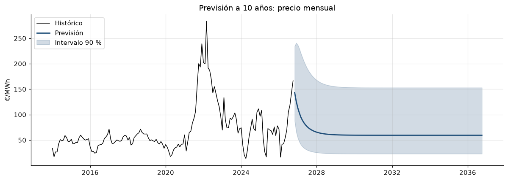

| Año | 2027 | 2028 | 2029 | 2030-2036 |
|---|---|---|---|---|
| Central (€/MWh) | 82,2 | 62,3 | 59,9 | 59,5 |
| Intervalo 90 % | 34-198 | 24-160 | 23-154 | 23-153 |

## 4.8 Aplicación al CPD: coste energético y peso en la punta

Escenario de ejemplo: CPD de **50 MW de potencia TI**, PUE 1,3 y factor de carga del 75 %.

- Consumo: 50 × 0,75 × 1,3 × 8.760 h = **427 GWh/año**, el **0,16 %** de la demanda nacional prevista.
- Coste de la energía (solo precio de mercado, sin peajes ni cargos):

| Año | Optimista | Central | Pesimista |
|---|---|---|---|
| 2027 | 14,6 M€ | **35,1 M€** | 84,4 M€ |
| 2028 | 10,4 M€ | **26,7 M€** | 68,6 M€ |
| 2030 en adelante | 9,9 M€ | **25,4 M€** | 65,3 M€ |

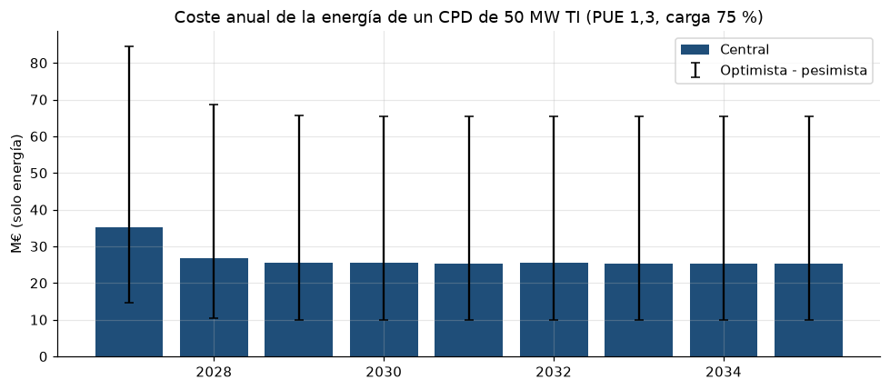

**Peso en la punta.** En la hora punta hay que suponer el CPD a plena potencia: 50 MW × 1,3 = **65 MW**, un **0,14 %** de la punta prevista de 47 GW (`punta.peso_en_punta`). A nivel nacional es poco, pero las redes de distribución y los nudos de conexión tienen capacidades de decenas o centenares de MW. Por eso la disponibilidad real se decidirá por la capacidad de acceso del nudo cercano a cada municipio, que se integrará en la puntuación de viabilidad.

La amplitud entre escenarios (de 10 a 65 M€ al año) muestra que **el precio de la energía es el principal riesgo económico** del CPD. Recomendaciones que se derivan del análisis:

1. Asegurar parte del suministro con **contratos a largo plazo (PPA)** para reducir la exposición al escenario pesimista.
2. Instalar **fotovoltaica propia**: cubre las horas de mediodía, que ya son las más baratas, así que su valor está en la reducción de consumo de red más que en el arbitraje de precio.
3. Mejorar el **PUE**: pasar de 1,3 a 1,2 ahorra un 7,7 % de la factura (unos 2 M€/año en el escenario central).

## 4.9 Conclusiones y limitaciones

| Conclusión | Evidencia |
|---|---|
| La demanda es muy predecible a corto plazo | MAPE del 2,94 % a 30 días (1,82 % en la primera semana), un 48 % mejor que el modelo ingenuo |
| La punta del sistema ya es de verano y está creciendo | Récord de 45.772 MW el 23-07-2026 a las 14 h; en 2026 la punta de verano supera a la de invierno |
| La punta es predecible a 1 semana pero difícil a 30 días | MAPE de 2,78 % en los días 1-7 y de 5,92 % en los días 8-30; a 1 día, REE es el referente (0,78 %) |
| La temperatura es el principal factor externo de la demanda | Forma de U con mínimo a 18 °C; +24 % a 28 °C; −19 % de error al incluirla |
| La demanda nacional está estable; el crecimiento vendrá de nuevos consumos | Serie plana 2011-2025 y previsión de unos 265 TWh/año |
| El precio es poco predecible y muy volátil | Mejora pequeña frente al ingenuo; crisis de 2021-2023 y subida de 2026 |
| El perfil horario del precio ha cambiado por la solar | Valle de 25 €/MWh a mediodía en 2026 |
| El coste energético de un CPD grande es de decenas de M€ al año con gran incertidumbre | 25 M€ central (10-65 M€) para 50 MW |

**Limitaciones y mejoras previstas**:

- Añadir como variables el precio del gas (MIBGAS), los derechos de CO₂ y la previsión de producción eólica y solar de REE para mejorar el modelo de precio.
- Probar previsiones meteorológicas a más de 7 días (AEMET publica tendencias) para acercarse al 2,32 % del máximo teórico.
- Bajar al nivel municipal: la demanda por municipio no es pública en abierto. Se usará la demanda autonómica y la capacidad de acceso de la red en los nudos (REE) para el factor energético de la puntuación de viabilidad.
- Incluir peajes, cargos e impuestos de la tarifa de acceso de alta tensión en el coste (`cargos_eur_mwh`).
